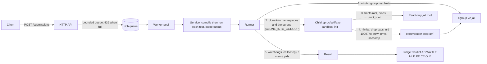

# code-execution-sandbox

A **secure code-execution sandbox and online-judge backend in Go**: untrusted C, C++, Java, JavaScript and Python programs run inside Linux **namespaces**, a **cgroup v2** resource jail, a read-only **`pivot_root`** filesystem, **rlimits**, dropped privileges and a hand-built **seccomp-bpf** allowlist, behind an HTTP API with a bounded queue and worker pool.

[](https://github.com/Alkarim786/code-execution-sandbox/actions/workflows/ci.yml)

-lightgrey)


> Project 21 of Karim's 30 Days, 30 Projects series.

> **Platform note.** The sandbox uses Linux kernel features and **only runs on Linux (amd64) as root**. Development here was on Windows 11, so all kernel-level tests ran inside a privileged Docker container on Docker Desktop's WSL2 kernel (6.18, cgroup v2), and CI runs the same container on `ubuntu-latest`. The portable logic (seccomp policy interpreter, judge, service, HTTP queue) is also tested natively on Windows and Linux.

## Why this exists

Every online judge, coding-interview platform and "run this snippet" feature has the same problem: executing code written by strangers on your servers. A fork bomb, a memory hog, a socket to your internal network, or a kernel exploit attempt must not take the host down or leak anything. This project builds the isolation layers by hand (instead of wrapping Docker or nsjail) so each defence, and each way it can fail, is visible, tested against actual malicious programs, and measured.

## Defence in depth

| Layer | Mechanism | What it stops |
|---|---|---|
| Namespaces | `CLONE_NEWUSER NEWNS NEWPID NEWNET NEWUTS NEWIPC NEWCGROUP` | sees no other processes (PID 1 in its own tree), no host network (only a *down* loopback), own hostname/IPC, host uid 0 is unreachable |
| User namespace | jail uid/gid 0 = unprivileged host uid 100000; program runs as uid 1000 | a "root" inside the jail is a nobody outside |
| Filesystem | tmpfs root + read-only bind of `/usr`, minimal read-only `/etc`, `pivot_root` then detach the old root, tmpfs `/tmp` `/work` | no path to host files, `/etc/shadow`, other jobs, or the sandbox's own state; nothing persistent; writes outside tmpfs fail with `EROFS` |
| cgroups v2 | `memory.max`, `memory.swap.max=0`, `memory.oom.group=1`, `pids.max`, `cpu.max` (1 CPU) | memory hogs (OOM kills the whole jail), fork/thread bombs, multi-thread CPU abuse; `cgroup.kill` kills everything atomically |
| rlimits | `CPU`, `FSIZE`, `NOFILE`, `STACK`, `CORE=0` | huge files, fd exhaustion, core dumps |
| Privileges | bounding set emptied, `setresuid(1000)`, `PR_SET_NO_NEW_PRIVS` | gaining capabilities back, setuid binaries |
| seccomp-bpf | allowlist of 173 syscalls (run profile) built by hand, arch + x32 check, argument filters; everything else kills the process (`SIGSYS`) | `ptrace`, `mount`, `unshare`, `setns`, `chroot`, `bpf`, `keyctl`, module loading, raw sockets, etc. |
| Watchdogs | wall-clock timer, CPU-time poller, output cap | sleeping programs, infinite loops, output floods |

The seccomp **run profile** is stricter than the compile profile: it forbids `fork`/`vfork` and permits `clone` only with `CLONE_THREAD` and no `CLONE_NEW*` flag, so a judged program can create threads but never new processes. `clone3` (whose flags live behind a pointer and cannot be filtered) returns `ENOSYS`, so glibc falls back to the filterable `clone`. Only `AF_UNIX` sockets are allowed (the JVM uses them internally); `AF_INET` and friends fail with `EAFNOSUPPORT`.

## Architecture



**Data flow.** A submission is validated (language, sizes, limits clamped to server maxima) and queued. A worker writes the source into a per-job directory (`/in`, read-only for the program; `/out`, a size-capped tmpfs for compiled artifacts). Compilation runs in the sandbox with the *toolchain* profile and a writable `/out`; every test then runs in a fresh sandbox with the *run* profile and a read-only `/out`. The runner creates the cgroup with all limits **before** the child exists and starts the child *inside it* via `CLONE_INTO_CGROUP`, so there is no window where the program is unconstrained. The child is the same binary re-executed (`/proc/self/exe __sandbox_init`, the `runc`/`reexec` trick): it builds the filesystem jail as PID 1 of the new namespaces, drops privileges, installs seccomp and `execve`s. Setup failures travel back over a pipe that closes on `execve`, so success reads as EOF. The parent then enforces wall/CPU/output limits and reads `cpu.stat`, `memory.peak`, `pids.peak` and `memory.events` to build the verdict.

## Tech stack

| Choice | Why |
|---|---|
| Go + `golang.org/x/sys/unix` only | single static binary that can re-exec itself; direct access to `clone`, `pivot_root`, `prctl`; no CGO, no libseccomp |
| Hand-written BPF assembler + interpreter | the filter is plain data I can unit-test *without a kernel* (`Eval`), size-check (398 instructions, kernel limit 4096) and reason about |
| cgroup v2 | one unified hierarchy; `cgroup.kill`, `memory.peak`, `pids.peak`, `memory.oom.group` are exactly the primitives a judge needs |
| tmpfs everywhere | nothing persists, sizes are hard-capped, cleanup is an unmount |
| In-memory queue + worker pool | bounded back-pressure (HTTP 429) is the point; a durable broker is a roadmap item |

## Features (implemented)

- 5 languages (C, C++, Java, JavaScript, Python), compile + per-test run, verdicts **AC / WA / TLE / MLE / RE / CE / OLE** (+ IE for sandbox faults)
- Separate seccomp profiles for toolchains and judged programs; seccomp violations reported explicitly
- Per-request limits (`cpu_ms`, `memory_mb`, `stack_mb`) clamped to server maxima; wall limit derived from CPU limit
- Async API with polling, `?wait=1`, bounded queue, worker pool, in-memory store with eviction
- Judge normalisation (trailing whitespace / blank lines)
- Guaranteed cleanup (cgroup removed, tmpfs unmounted, no leftover processes), checked by a test that runs after all the malicious programs
- Benchmarks for startup overhead and throughput

## Roadmap (not built)

- Comparison against gVisor / nsjail, and a pluggable "stronger isolation" backend (microVM) for hostile multi-tenant use
- Interactive problems, special judges, multiple source files
- Caching compiled binaries (the same source recompiles every time today)
- Per-job disk quotas for `/tmp` and `/work` beyond tmpfs size, per-tenant rate limits
- Rootless operation, arm64 seccomp tables, durable queue and result storage
- A judge web UI

## Quick start

```bash
docker compose up --build judge        # http://localhost:8080  (needs privileged: it builds namespaces, mounts and cgroups)
```

```bash
curl -s -X POST 'localhost:8080/submissions?wait=1' -H 'content-type: application/json' -d '{
  "language": "c",
  "source": "#include <stdio.h>\nint main(){int a,b;scanf(\"%d %d\",&a,&b);printf(\"%d\",a+b);}",
  "tests": [{"input":"2 3","expected":"5"},{"input":"10 20","expected":"30"}]
}'
```
```json
{"id":"b984bbcc6cbf190c","status":"done","language":"c","total_ms":330,
 "result":{"verdict":"AC","compile_ms":239,"tests":[
   {"index":0,"verdict":"AC","cpu_ms":19,"wall_ms":13,"memory_kb":3056,"stdout":"5"},
   {"index":1,"verdict":"AC","cpu_ms":39,"wall_ms":33,"memory_kb":2660,"stdout":"30"}]}}
```

A fork bomb and a network attempt, run through the real container:

```text
python: import os; while True: os.fork()
 -> {"verdict":"RE","tests":[{"verdict":"RE","reason":"killed by seccomp: forbidden system call","cpu_ms":70,"wall_ms":106}]}
python: import socket; socket.socket()
 -> RE, stderr "OSError: [Errno 97] Address family not supported by protocol"
```

Local development on any OS: `go test ./internal/judge ./internal/service ./internal/server ./internal/sandbox` runs the portable tests. The kernel-level suite: `docker compose --profile test run --rm test`. Benchmarks: `docker compose --profile bench run --rm bench`.

Linux without Docker: build `go build ./cmd/sandboxd` and run as **root** on a cgroup v2 host with `python3 gcc g++ nodejs default-jdk-headless` installed; the host's `/usr` is bind-mounted read-only into every jail. On Ubuntu 24.04+ you may need `sysctl kernel.apparmor_restrict_unprivileged_userns=0`.

## API reference

| Endpoint | Purpose |
|---|---|
| `POST /submissions[?wait=1]` | body `{language, source, tests:[{input, expected}], limits:{cpu_ms, memory_mb, stack_mb}, stop_on_fail}`; `202 {id, status}` or, with `wait=1`, the finished submission; `400` invalid; `429` queue full (`Retry-After: 1`) |
| `GET /submissions/{id}` | `status: queued/running/done`, `queue_ms`, `total_ms`, `result{verdict, compile_output, compile_ms, tests[]}` |
| `GET /languages` | supported languages |
| `GET /health` | queue length and counters |

Server-side ceilings: source 256 KB, 100 tests, 1 MB per input/expected, CPU 10 s, memory 1 GiB, stack 256 MiB. Defaults: CPU 2 s, memory 256 MiB, 32 pids, 16 MiB files/tmpfs, 1 MiB output.

## Testing

49 test functions (73 with subtests), all passing: 27 portable unit tests and 22 kernel-level integration/security tests.

```bash
go vet ./... && go test ./internal/judge ./internal/service ./internal/server ./internal/sandbox   # any OS
docker build -f Dockerfile.test -t sandbox-test . && docker run --rm --privileged sandbox-test go test -count=1 -v ./...
```

**Portable (ran on Windows locally; CI runs them on Ubuntu and Windows):** the BPF assembler/interpreter (allow, deny, errno, argument filters, `clone` flag filters, wrong arch, x32 aliasing, size limit), the real seccomp policies evaluated without a kernel (21 dangerous syscalls killed, only `AF_UNIX` sockets, run vs toolchain `fork`), verdict classification and output comparison, submission pipeline with a fake runner (compile errors, stop-on-fail, profile/mount choice, limit clamping), and the HTTP queue (202 vs 200, worker-pool bound, 429 back-pressure).

**Kernel-level (privileged container on WSL2; CI repeats it on `ubuntu-latest`), each uses a real malicious program:**

| Attack | Result |
|---|---|
| Fork bomb (cgroup layer, fork allowed) | stopped at 15 forks with `EAGAIN`, `pids.peak` = 16 = the limit |
| `fork()` in the run profile | killed by seccomp, reported as RE "forbidden system call" |
| Thread bomb | `can't start new thread`, `pids.peak` <= limit |
| Memory hog (Python and C, 64 MB limit) | MLE via cgroup OOM, peak stays near the limit |
| Infinite loop, 500 ms CPU limit (Python, C) | TLE at 510 and 513 ms CPU |
| `sleep(100)` | TLE by wall clock with almost no CPU used |
| Output flood | OLE |
| 100 MB file write, tmpfs fill | `EFBIG` / `ENOSPC` |
| Stack overflow | RE |
| `socket(AF_INET)` | refused by seccomp (`EAFNOSUPPORT`); with seccomp *disabled*, `connect` fails with `ENETUNREACH` and only `lo` exists |
| Read `/etc/shadow`, `/root`, `/var`, host work dir, `../../..` traversal, `/proc/1/root` | all absent; `/etc/passwd` has no host users |
| Write to `/usr`, `/etc`, `/bin` | `EROFS`; writing `/` gives `EACCES`; `/tmp` and `/work` work |
| Process identity | uid/gid 1000, PID 1, hostname `sandbox`, `CapEff/CapBnd/CapPrm = 0`, `NoNewPrivs 1`, `Seccomp 2`, only PID 1 visible in `/proc` |
| 17 escape syscalls (`ptrace mount umount2 chroot pivot_root unshare setns reboot setuid keyctl bpf init_module kexec_load open_by_handle_at process_vm_readv perf_event_open userfaultfd`) | every one kills the process with `SIGSYS` |
| `clone(CLONE_NEWUSER\|CLONE_NEWNET)` | killed even though thread clones work |
| Compiler abuse: `#include "/etc/shadow"`, `#include </dev/zero>`, macro explosion, 1 TB bss | CE (or untouched virtual memory not charged); no host data leaked; contained in 11 s |
| After all of the above | no leftover cgroups, processes, mounts or job directories |

Correctness: Python, C, C++, JavaScript and Java each compile/run, give AC on a stdin sum, WA, RE and (where relevant) CE; C and JavaScript worker threads work in the run profile; 16 concurrent submissions do not interfere; a 500 KB output is accepted.

## Benchmarks

Environment: AMD Ryzen 5 7520U laptop, Windows 11, **Docker Desktop on WSL2** (privileged container, 8 vCPUs visible, Linux 6.18, cgroup v2). This is a nested-virtualisation setup, so timings are **noisy**; I ran the full benchmark twice, back to back, and show both runs. `go run ./cmd/bench`, n = 100 per startup cell, 200 submissions per throughput cell, 5 warm-up runs. Raw output: [docs/bench-run1.md](docs/bench-run1.md), [docs/bench-run2.md](docs/bench-run2.md).

**Startup overhead, p50 (ms), one execution:**

| Program | Bare `exec`, no isolation | Sandboxed, run 1 / run 2 | Of which host setup (cgroup + clone), run 1 / run 2 |
|---|---|---|---|
| `/usr/bin/true` (pure sandbox cost) | 2.6 | 82.8 / 23.5 | 20.6 / 7.9 |
| `python3 -c pass` | 48.8 / 18.5 | 109.0 / 37.2 | 15.2 / 7.2 |
| `node -e 0` | 488.5 / 459.0 | 845.4 / 518.4 | 25.1 / 11.2 |
| `java -version` | 167.6 / 167.7 | 180.0 / 229.1 | 10.6 / 11.6 |

Reading it: building the whole jail (cgroup, 7 namespaces, tmpfs root, ~12 mounts, `pivot_root`, seccomp) costs roughly **20-80 ms** per execution on this machine, with p95 several times higher in the noisy run. That is small next to JVM or Node start-up and the gcc compile, but it is the floor for a trivial program. The jail setup is also repeated per test case (a deliberate trade-off for isolation between tests).

**Throughput (submissions/s, full pipeline), run 1 / run 2:**

| Workload | 1 worker | 2 | 4 | 8 |
|---|---|---|---|---|
| Python, 1 test, no compile | 15.7 / 11.0 | 16.1 / 11.6 | 47.7 / 14.5 | 50.2 / 20.3 |
| C, gcc compile + 1 test | 2.7 / 3.3 | 12.7 / 5.1 | 20.5 / 5.0 | 23.9 / 6.9 |

All 1,000 submissions in each run (800 Python, 200 C) were judged AC. Scaling with workers is real but erratic (run 2 saturates far earlier); I would not quote a single number from this setup. On bare-metal Linux I would expect lower overhead and steadier scaling, but I have not measured that.

Language timings from the integration test (single runs, vary a lot): Python 52-117 ms run, C 10-15 ms run (0.1-0.3 s compile), C++ 16-38 ms (1.3-4 s compile), JavaScript 0.37-1.8 s, Java 0.3-0.4 s run (3.7-6.7 s `javac`).

## Key engineering decisions and trade-offs

- **Born inside the cgroup.** `CLONE_INTO_CGROUP` (Go's `UseCgroupFD`) removes the classic race between fork and "move PID into cgroup".
- **Allowlist, built empirically.** Starting from knowledge of what glibc needs, I ran each runtime under `strace` (`scripts/trace-syscalls.sh`) and diffed against the policy: this found that Node probes `pkey_alloc` (now `ENOSYS`) and that the JVM and `javac` need `AF_UNIX` sockets. The allowlist is only *verified* for these five runtimes, so other programs may need additions.
- **Fail soft vs kill.** Probes with a safe fallback (`clone3`, `io_uring_*`, `pkey_*`, `openat2`) return `ENOSYS`; genuine attack syscalls kill the process. `ioctl` and `prctl` are argument-filtered rather than blocked.
- **Verdict ordering.** Resource limits are judged before exit status (OOM, output cap, wall, CPU), then seccomp, then signals, then exit code, because killing for a limit also produces an "abnormal" exit.
- **PID 1 semantics.** The program is PID 1 of its namespace (no extra init process). It cannot be signalled from outside except by the cgroup, and orphaned zombies are not reaped, which is acceptable because `pids.max` bounds them and teardown kills the namespace.
- **Mount flags in a user namespace.** Read-only bind mounts must be remounted *preserving* the inherited `nosuid/nodev/noexec` flags (they are locked in a user namespace); the code reads them with `statfs`.
- **`/out` handoff.** Compilation writes to a size-capped tmpfs that the run step mounts read-only, so a malicious binary cannot tamper with the artifact between tests.
- **Bugs found by the tests, worth knowing:** the child had no capabilities until its credentials were set to ns-uid 0 (host uid 0 was unmapped); `MkdirTemp` directories (0700) were unreadable to the jail's host uids; Go prints signals as text ("bad system call"), so `SIGSYS` detection needed `unix.SignalName`; a stack-overflow test was flaky because faulting in 64 MB of stack is slow on this VM, which led to the `stack_mb` limit.

## Limitations (honest threat model)

- It shares the **host kernel**. A kernel vulnerability reachable through the ~170 allowed syscalls could escape; for hostile multi-tenant use, put this inside a microVM or use gVisor/Firecracker (roadmap).
- It must run **privileged** (root, `CAP_SYS_ADMIN`, writable cgroup v2) because it creates namespaces, mounts and cgroups per submission. The daemon itself is therefore a high-value target; protect its API.
- `execve` is allowed, so a program can run any binary on the read-only `/usr` (still inside the same jail).
- No protection against side channels (Spectre-class) or cross-job CPU cache effects; `cpu.max` gives 1 CPU worth of time per job, not a CPU pin.
- Memory accounting (`memory.max`) includes page cache and tmpfs; CPU time is read from cgroup accounting, which on a VM includes time stolen by the hypervisor (the cause of occasional CPU-limit false positives I saw in the noisy runs).
- Seccomp tables are linux/amd64 only. `/work` and `/tmp` tmpfs sizes are capped; total disk used across concurrent jobs is not separately quota'd.

## Project structure

```
cmd/sandboxd/            HTTP daemon        cmd/bench/       startup + throughput benchmark
internal/sandbox/        spec.go bpf.go (assembler+interpreter) policy_linux_amd64.go seccomp_linux_amd64.go
                         cgroup_linux.go init_linux.go (child) run_linux.go (host) run_other.go (stub)
internal/judge/          verdicts and output comparison
internal/languages/      per-language compile/run commands
internal/service/        submission pipeline (Runner interface, adapter)
internal/server/         HTTP API, queue, workers
internal/integration/    malicious-program and correctness tests (Linux, privileged)
scripts/trace-syscalls.sh   strace-based allowlist audit
docs/                    bench-run1.md bench-run2.md
Dockerfile  Dockerfile.test  docker-compose.yml  .github/workflows/ci.yml
```
